# Canvas & Co. — Art Gallery Website

## Project topic
A modern, responsive website for an independent art gallery.

## Group members
- Dinislam Mirzadiyar
- Aitken Tamerlan

## Project description
Canvas & Co. is a responsive, multi-page art gallery website. Visitors can learn about the gallery, explore a curated artwork collection, discover exhibitions and ticket information, and contact the gallery. The Endterm version extends the original Midterm website with client-side interactivity using JavaScript and jQuery while preserving the original topic, page structure, visual identity, and responsive layout.

## Features implemented

### Existing Midterm features
- Five connected pages: Home, About, Gallery, Exhibitions, and Contact.
- Shared navigation and footer across the website.
- Semantic HTML5 structure and descriptive image alternative text.
- Responsive layouts using CSS Grid, Flexbox, media queries, and Bootstrap 5.3.3.
- Artwork collection, exhibition information, and ticket-price table.
- Existing contact information and visual design system.

### Endterm enhancements
- **Registration form validation:** required-field checks, email validation with a regular expression, password-strength indicator (Weak / Medium / Strong), password confirmation, inline feedback, and submission prevention when validation fails.
- **Dynamic artwork search and filtering:** case-insensitive live search by artwork title, artist, and image description; category filters; combined search and category filtering; live result count; no-results message.
- **CRUD artwork manager:** dynamically renders artwork records and supports Create, Read, Update, and Delete operations. Delete requires confirmation. Records are saved in browser `localStorage`.
- **Interactive image gallery:** click an artwork to open a lightbox, navigate with previous/next arrows or keyboard arrow keys, and close with Escape or the close button. jQuery fade and animation effects are used for transitions.
- **Shared JavaScript file:** interactive behavior is organized in `js/script.js`.

> **Note:** This is a front-end educational project. The registration form does not create real accounts or transmit personal data. CRUD records are stored locally in the current browser and are not synchronized with a server.

## Technologies used
- HTML5
- CSS3
- Bootstrap 5.3.3
- JavaScript (ES6)
- jQuery 3.7.1
- Browser `localStorage`
- Google Fonts (DM Sans and Playfair Display)

## Individual contributions
- **Dinislam Mirzadiyar:** project structure, page integration, responsive layout, and README documentation.
- **Aitken Tamerlan:** Gallery and Exhibitions pages, artwork images and descriptions, and improvements to the website layout and responsive design.

## Project links
- **GitHub repository:** https://github.com/dmirzadiyar/art-gallery
- **Published website:** https://dmirzadiyar.github.io/art-gallery/

> If the published website link does not open, enable GitHub Pages for the repository (Settings → Pages → Deploy from a branch → `main` / root), then verify the deployment URL.

## Screenshots
The `screenshots/` folder contains the original Midterm screenshots. For the Endterm submission, capture and add updated screenshots showing:
1. Registration form validation and password strength.
2. Gallery search and category filters.
3. CRUD table with Add / Edit / Delete controls.
4. Lightbox with image navigation.

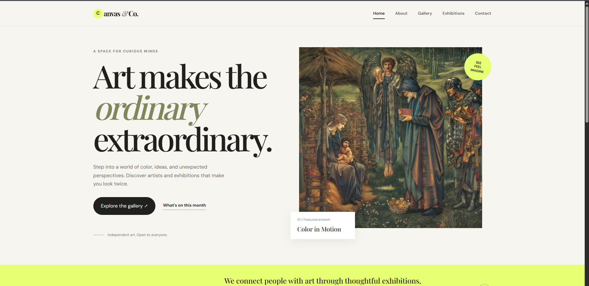
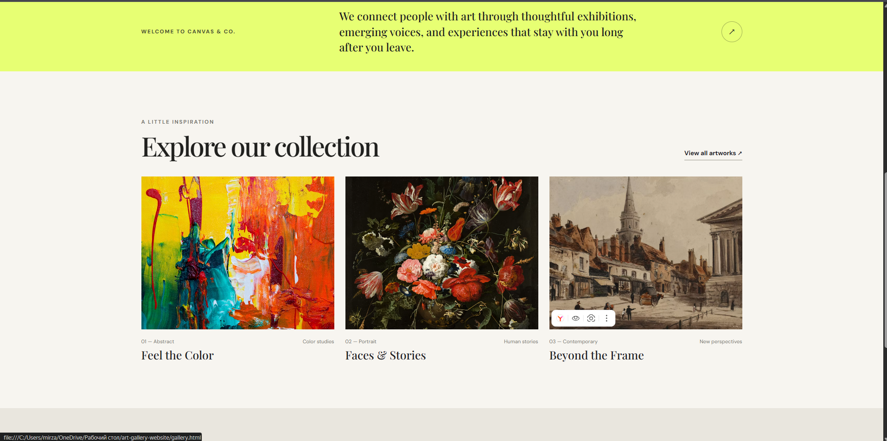
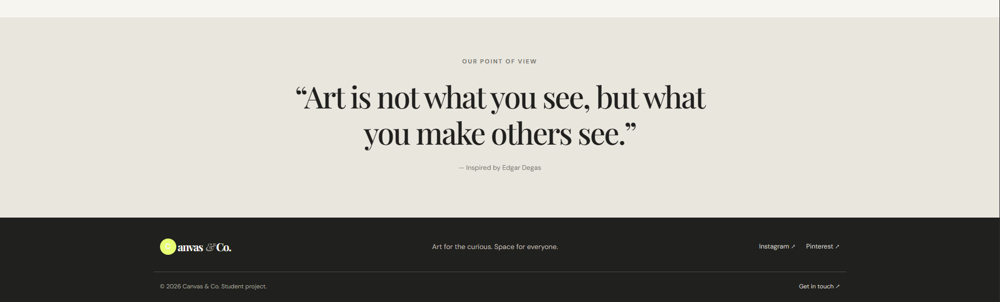
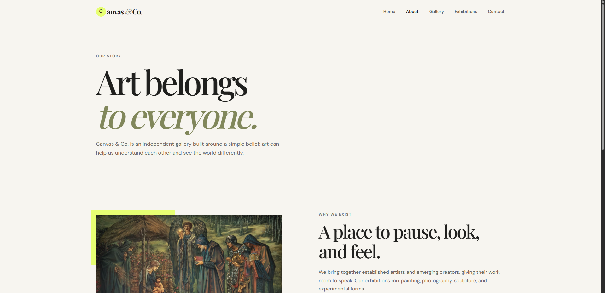
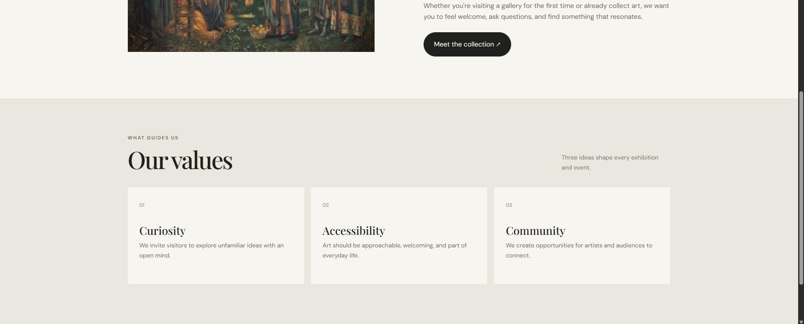
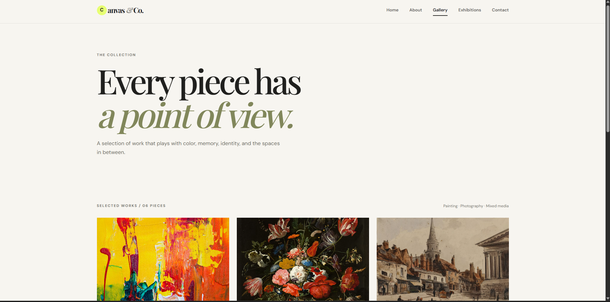
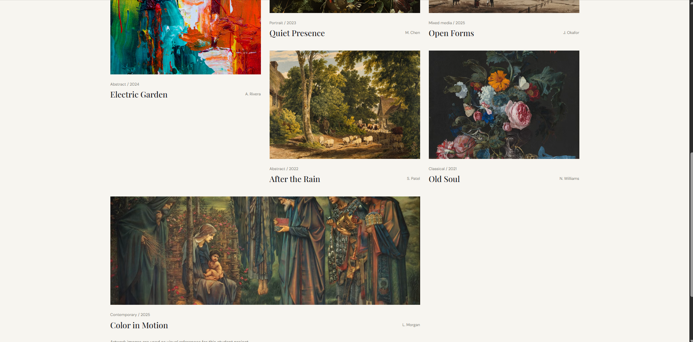
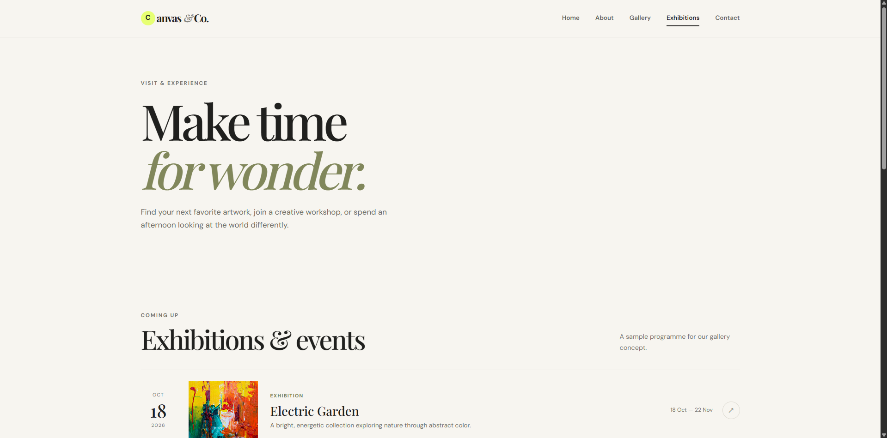
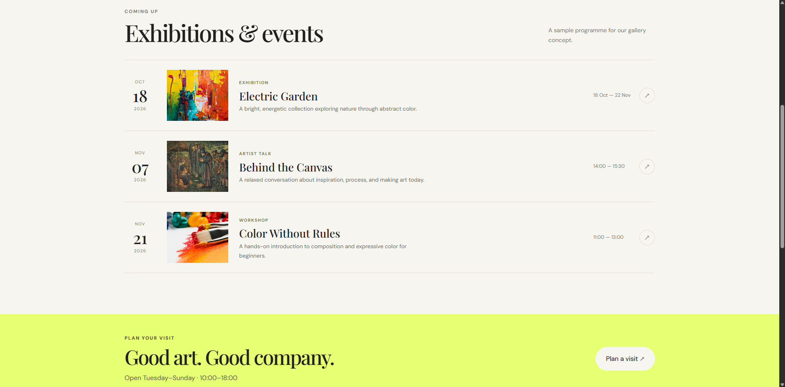
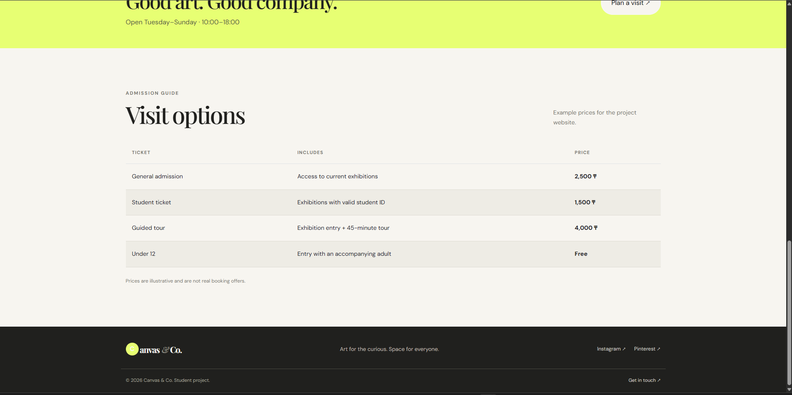
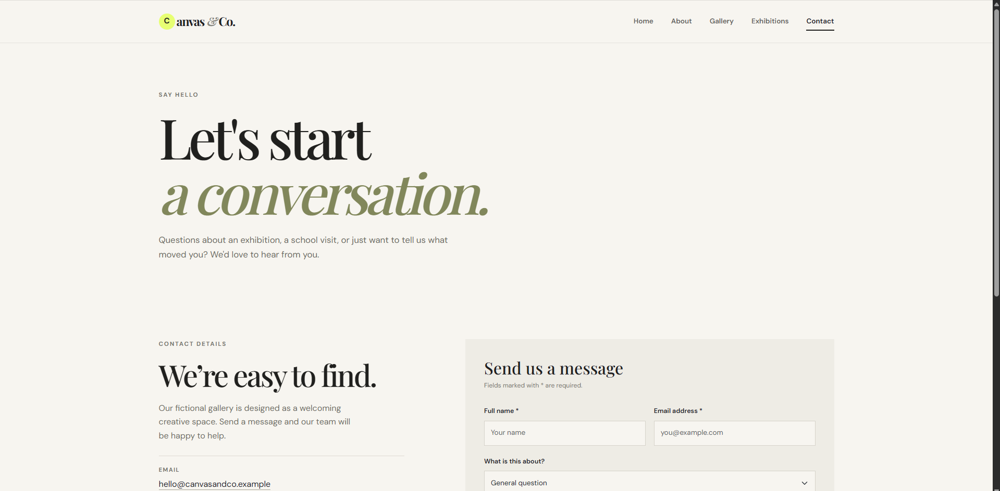
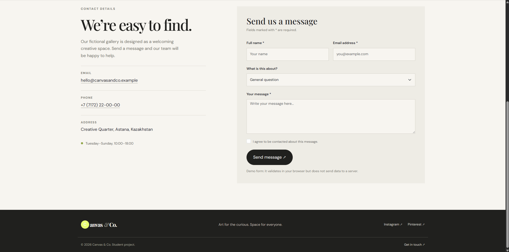
