# Art Gallery Website

## Topic
A modern art gallery website.

## Group members
Dinislam Mirzadiyar
Aitken Tamerlan 

## Project Overview

Canvas & Co. is a modern, responsive website designed for an independent art gallery. The main goal of this project is to create an attractive and user-friendly website where visitors can explore artworks, learn about the gallery, discover current exhibitions, and find contact information.

The website combines a clean layout, elegant typography, and artwork images to create a professional gallery experience. It is designed to work on desktop computers, tablets, and mobile devices.

## Description
Canvas & Co. is a responsive, multi-page website concept for an independent art gallery. Visitors can learn about the gallery, browse artworks, check exhibition information and prices, and use a contact form.

## Features implemented
Five connected pages: Home, About, Gallery, Exhibitions, and Contact.
Shared header with logo and Flexbox navigation on every page.
Semantic HTML5 structure: header, nav, main, section, article , and footer.
Art gallery image collection with descriptive alt text and lazy loading for below-the-fold images.
Exhibitions and ticket-price table.
Contact form with required fields and browser validation.
External CSS file with CSS variables, hover/focus states, pseudo-classes, positioning, Flexbox, and CSS Grid.
Responsive tablet and mobile breakpoints.
Bootstrap 5.3.3 grid, containers, spacing, buttons, and responsive utilities.
Google Fonts: DM Sans and Playfair Display.
Social links and contact information in the footer.

## Technologies used
HTML5
CSS3
Bootstrap 5.3.3
Google Fonts

## Individual contributions
Dinislam Mirzadiyar: project structure, page integration, responsive layout, and README.
Member 2: Developed the Gallery and Exhibitions pages, added artwork images and descriptions, and helped improve the website layout and responsive design.

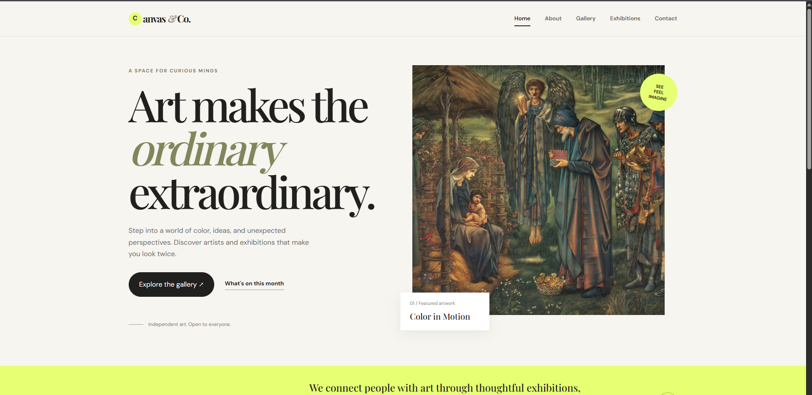
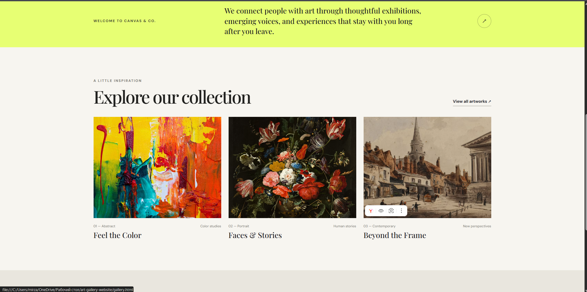
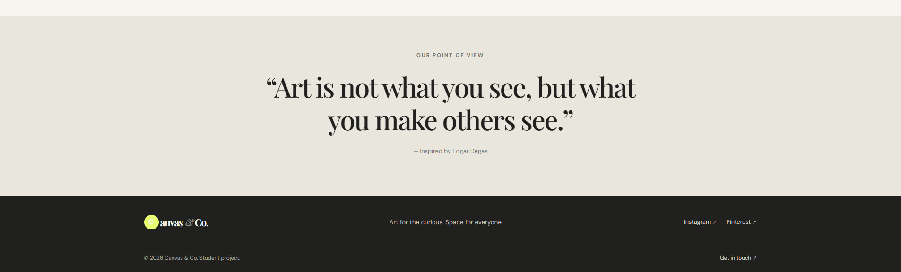
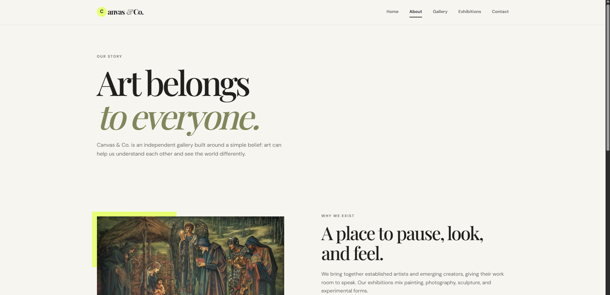
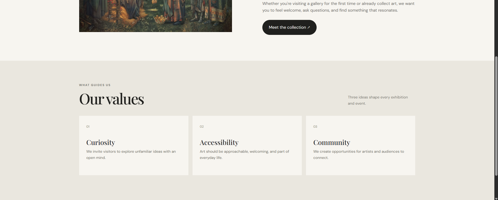
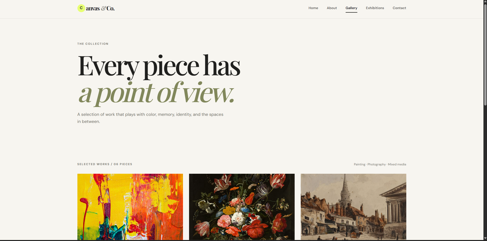
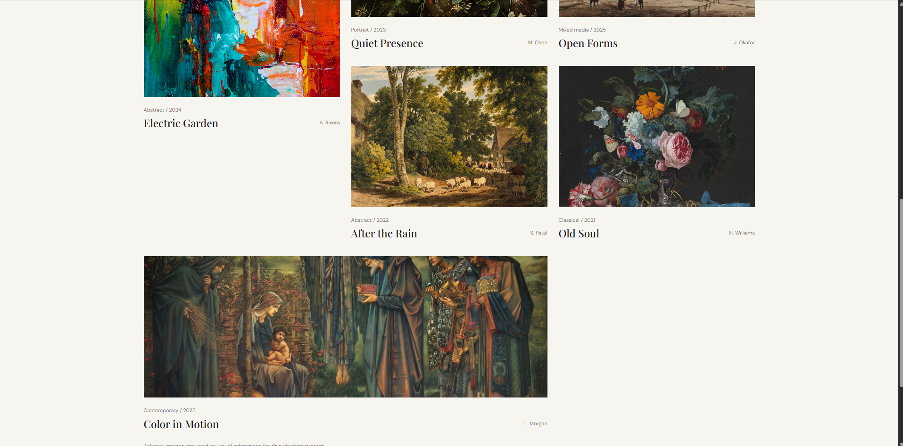
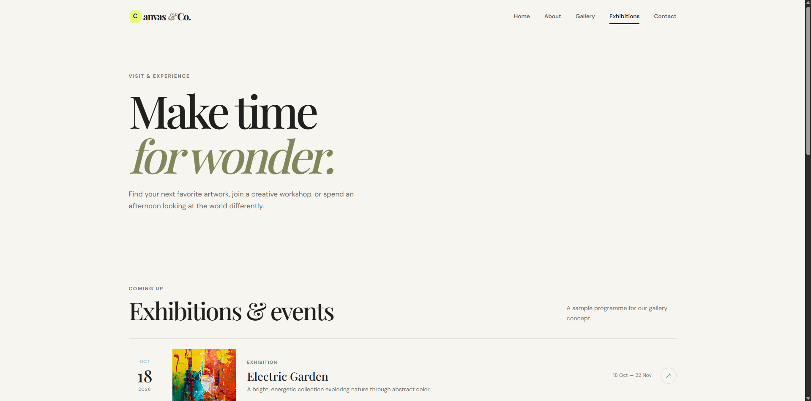
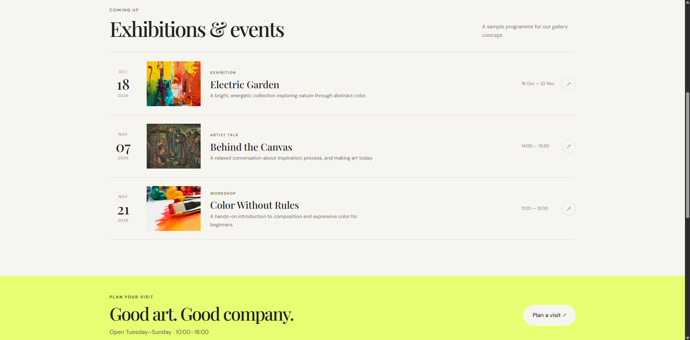
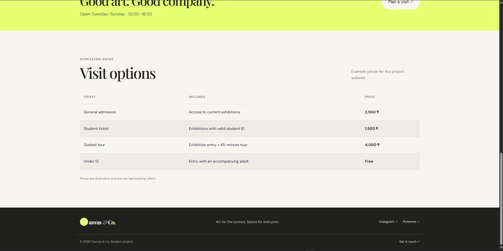

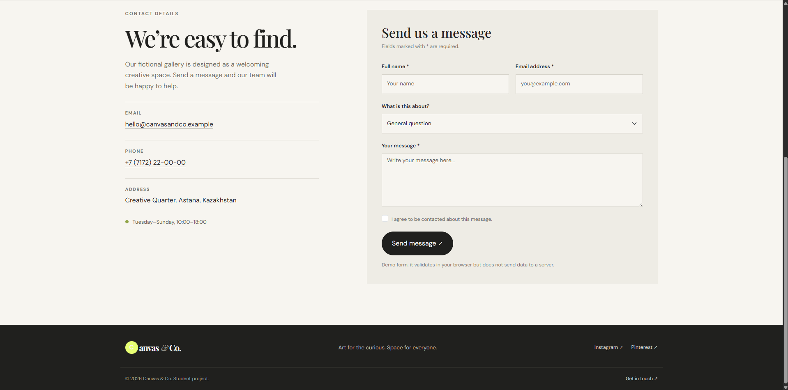