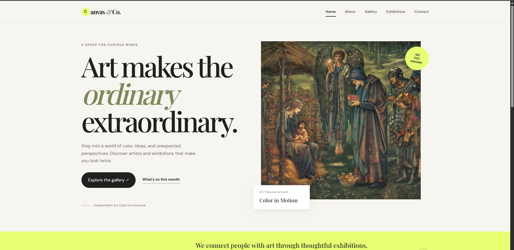
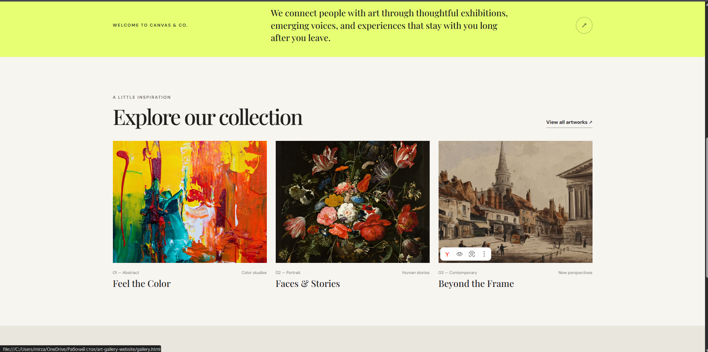
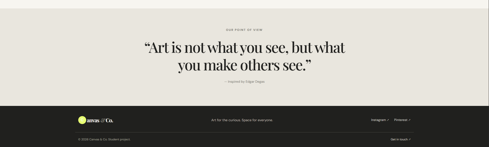
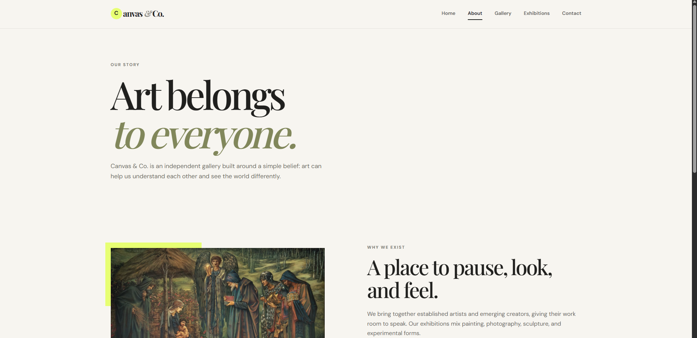
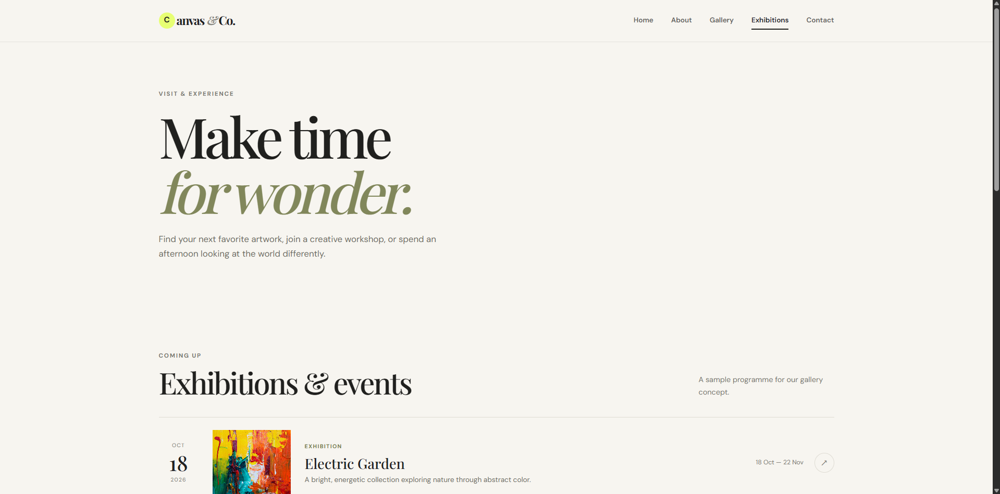
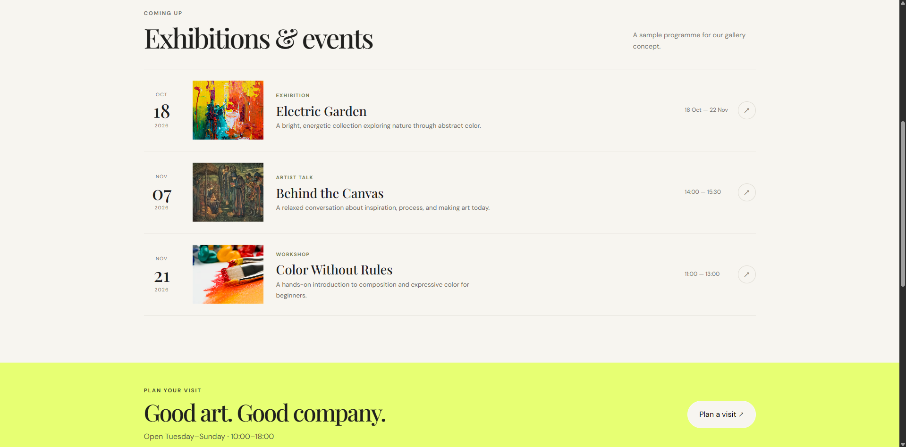
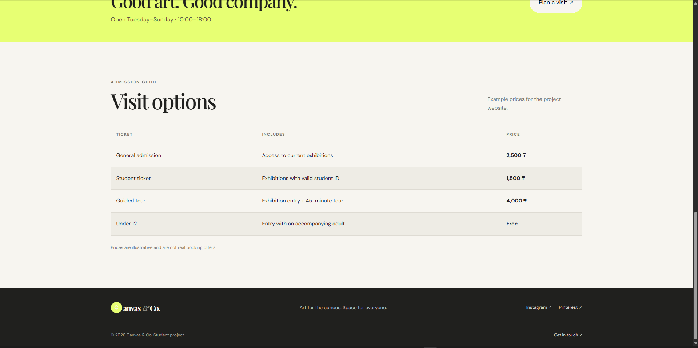
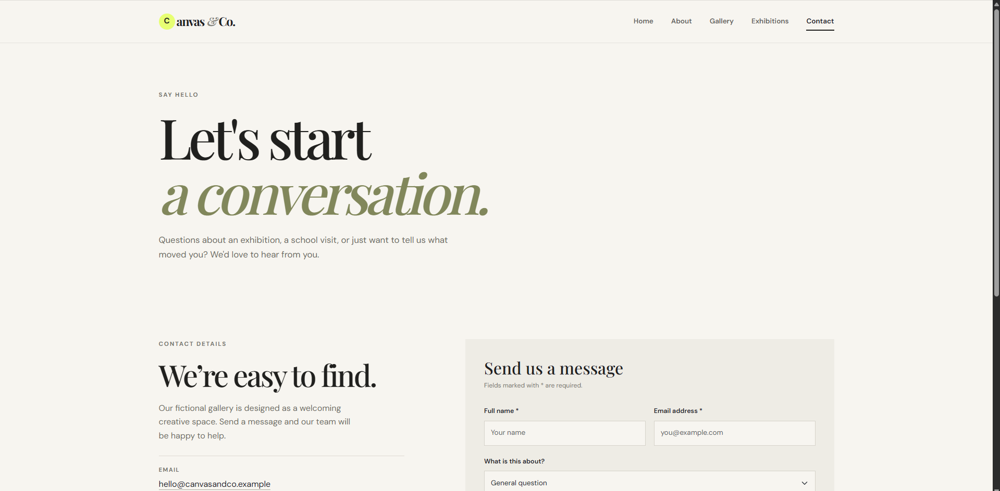
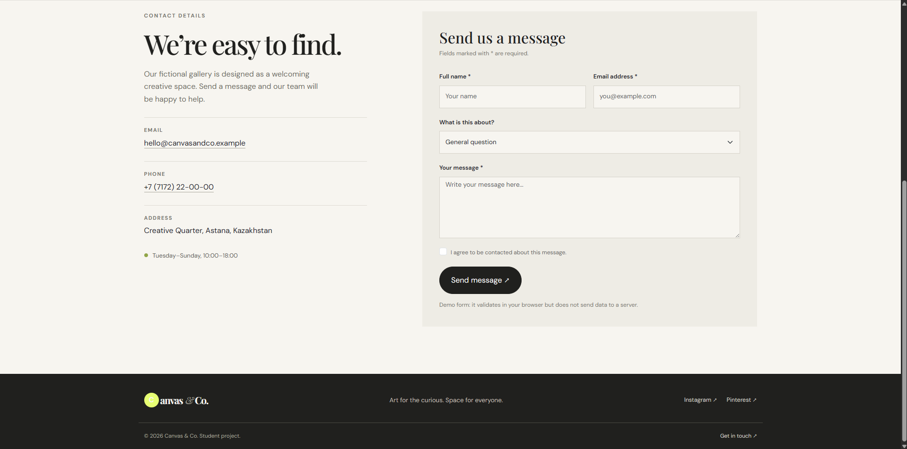

# Canvas & Co. — Art Gallery Website

## Project topic
A modern, responsive website for an independent art gallery.

## Group members
- Dinislam Mirzadiyar
- Aitken Tamerlan

## Project description
Canvas & Co. is a responsive, multi-page art gallery website. Visitors can learn about the gallery, explore a curated artwork collection, discover exhibitions and ticket information, and contact the gallery. The Endterm version extended the original Midterm website with client-side interactivity using JavaScript and jQuery. The Final version adds a light/dark theme, sign-in, an FAQ section, and live artwork data from a public museum API, while keeping the same topic, page structure, and visual identity.

## Features implemented

### Existing Midterm features
- Five connected pages: Home, About, Gallery, Exhibitions, and Contact.
- Shared navigation and footer across the website.
- Semantic HTML5 structure and descriptive image alternative text.
- Responsive layouts using CSS Grid, Flexbox, media queries, and Bootstrap 5.3.3.
- Artwork collection, exhibition information, and ticket-price table.
- Existing contact information and visual design system.

### Endterm enhancements
- **Registration form validation:** required-field checks, email validation with a regular expression, password-strength indicator (Weak / Medium / Strong), password confirmation, inline feedback, and submission prevention when validation fails.
- **Dynamic artwork search and filtering:** case-insensitive live search by artwork title, artist, and image description; category filters; combined search and category filtering; live result count; no-results message.
- **CRUD artwork manager:** dynamically renders artwork records and supports Create, Read, Update, and Delete operations. Delete requires confirmation. Records are saved in browser `localStorage`.
- **Interactive image gallery:** click an artwork to open a lightbox, navigate with previous/next arrows or keyboard arrow keys, and close with Escape or the close button. jQuery fade and animation effects are used for transitions.
- **Shared JavaScript file:** interactive behavior is organized in `js/script.js`.

### Final project features
- **Light/Dark theme toggle (all pages):** the ☾ / ☀ button in the header switches themes. The choice is saved in `localStorage` (`canvasCoTheme`) and restored on every page and after refresh. `js/theme-init.js` applies the saved theme in `<head>` before the page is drawn, so there is no flash of the wrong theme. All colors are CSS variables, with a dark set under `:root[data-theme="dark"]`; Bootstrap components follow via `data-bs-theme`.
- **Sign-in with localStorage (`signin.html` + header on all pages):** validated sign-in form (name, email format, password of at least 8 characters, inline feedback). On success only non-sensitive data — name, email, and sign-in time — is saved in `localStorage` (`canvasCoUser`); the password is never stored. The user stays signed in after refresh. Signed-in users see "Hi, *name*" and a Sign out button in the header, a profile card on the sign-in page, and their name and email filled in on the contact form. Sign out clears the saved state.
- **FAQ with jQuery (`about.html`):** six questions about visiting the gallery. Clicking a question opens or closes its answer with jQuery `.slideToggle()`; a + / − indicator and `aria-expanded` show the state.
- **Public API integration (`gallery.html`):** the "Explore a real collection" section loads artworks with `fetch()` from the [Cleveland Museum of Art Open Access API](https://openaccess-api.clevelandart.org/) (free, no key, CC0 data). JSON results are rendered as cards (image, title, artist, date, type, link to the museum). Users can search, pick a topic, filter by artwork type, and load more results. Errors are handled: HTTP errors, network failures, a 12-second timeout, empty searches, no results, and missing images, with a "Try again" button.

## Pages
| Page | File | Highlights |
|---|---|---|
| Home | `index.html` | Hero, featured collection, quote |
| About | `about.html` | Gallery story, values, **FAQ** |
| Gallery | `gallery.html` | Search/filter, lightbox, **live museum API** |
| Exhibitions | `exhibitions.html` | Events, ticket prices, artwork CRUD manager |
| Contact | `contact.html` | Contact details, validated registration form |
| Sign in | `signin.html` | **Sign-in form and profile** |

## Technologies used
- HTML5
- CSS3 (custom properties, Flexbox, Grid, media queries)
- Bootstrap 5.3.3
- JavaScript (ES6+, `fetch`, `async`/`await`)
- jQuery 3.7.1
- Browser `localStorage`
- Cleveland Museum of Art Open Access API
- Google Fonts (DM Sans and Playfair Display)

## Individual contributions
- **Dinislam Mirzadiyar:** project structure, page integration, responsive layout, and README documentation.
- **Aitken Tamerlan:** Gallery and Exhibitions pages, artwork images and descriptions, and improvements to the website layout and responsive design.

## Project links
- **GitHub repository:** https://github.com/dmirzadiyar/art-gallery
- **Published website:** https://dmirzadiyar.github.io/art-gallery/

## Screenshots
 

