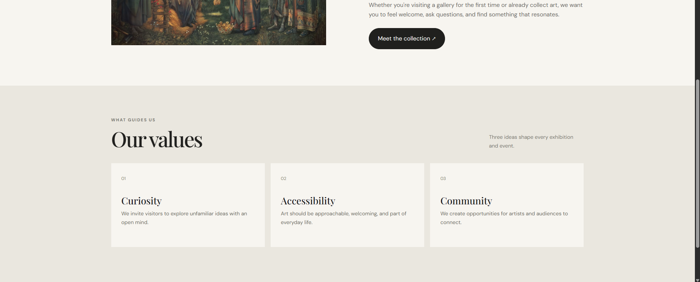
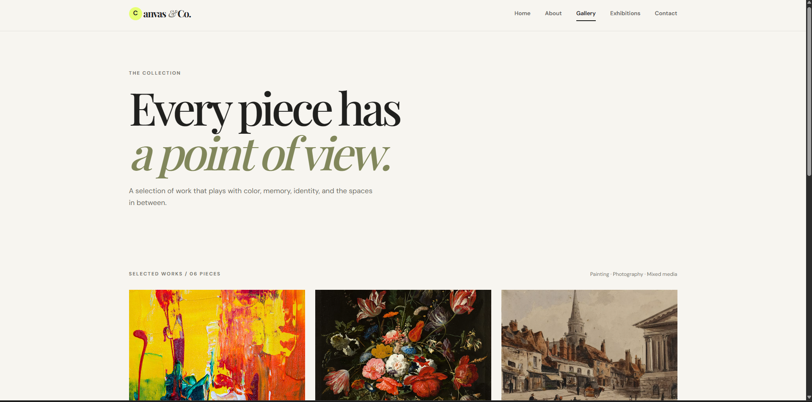
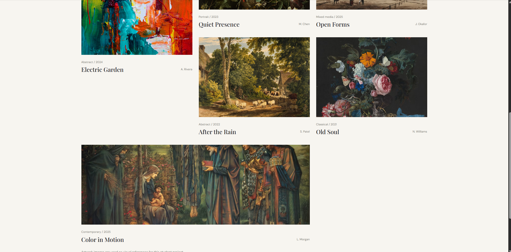

# Canvas & Co. — Art Gallery Website

## Project Overview

Canvas & Co. is a modern, responsive, multi-page website for an independent art gallery. It allows visitors to explore artwork collections, learn about the gallery, discover exhibitions, view ticket information, and contact the gallery.

The project was developed in stages. The original website was extended with JavaScript and jQuery functionality, followed by additional features for the Final Project, including a light/dark theme, client-side sign-in, an interactive FAQ, and integration with a public museum API.

## Group Members

- Dinislam Mirzadiyar
- Aitken Tamerlan

## Website Features

### Website Structure and Design

- Six connected pages: Home, About, Gallery, Exhibitions, Contact, and Sign In.
- Consistent navigation and footer across all pages.
- Semantic HTML5 elements and descriptive image alternative text.
- Responsive layouts using CSS Grid, Flexbox, media queries, and Bootstrap 5.3.3.
- Consistent typography, colors, and visual design.
- Artwork collections, exhibition information, and ticket pricing.

### JavaScript Functionality

- Form validation for names, email addresses, and passwords.
- Password-strength indicator with Weak, Medium, and Strong levels.
- Dynamic artwork search and category filtering.
- Combined search and category filtering with a live result counter.
- Artwork management with Create, Read, Update, and Delete (CRUD) operations.
- Persistent artwork records using browser localStorage.
- Interactive image lightbox with navigation, keyboard controls, and animation.

### Final Project Features

**1. Light/Dark Theme**

A theme toggle is available across all pages. The selected theme is stored in localStorage using the `canvasCoTheme` key and restored after refreshing or navigating between pages. The initial theme is applied before the page is displayed to prevent a flash of the wrong theme.

**2. Sign-in System**

The `signin.html` page provides a validated sign-in form with name, email, and password fields. After successful validation, the application stores the user's name, email, and sign-in timestamp in localStorage under the `canvasCoUser` key. Passwords are not stored.

Signed-in users see a personalized greeting and a Sign out button in the navigation. Their profile information is displayed on the sign-in page, and their contact details can be prefilled in the contact form. Signing out clears the saved user state.

This is a client-side demonstration and does not provide server-side authentication.

**3. Interactive FAQ**

The About page contains six frequently asked questions. jQuery's `.slideToggle()` method provides animated opening and closing of answers. The interface also updates the +/− indicator and `aria-expanded` attribute.

**4. Cleveland Museum of Art API Integration**

The Gallery page includes a live artwork collection powered by the Cleveland Museum of Art Open Access API.

The application uses JavaScript `fetch()` to retrieve JSON data and dynamically display artwork cards containing images, titles, artists, dates, techniques, and links to the museum.

Users can:
- Search for artists, styles, and subjects.
- Select predefined search topics.
- Filter artworks by type.
- Load additional results through pagination.

Error handling covers HTTP errors, network failures, request timeouts, empty searches, missing images, and empty results. A retry option is also provided.

API: https://openaccess-api.clevelandart.org/api/artworks/

## Website Pages

| Page | File | Description |
|---|---|---|
| Home | `index.html` | Introduction, hero section, and featured artwork |
| About | `about.html` | Gallery information, values, and FAQ |
| Gallery | `gallery.html` | Artwork collection, search, filters, lightbox, and museum API |
| Exhibitions | `exhibitions.html` | Exhibitions, ticket prices, and artwork management |
| Contact | `contact.html` | Contact information and validated form |
| Sign In | `signin.html` | Sign-in form and user profile |

## Technologies Used

- HTML5 — page structure and semantic elements.
- CSS3 — styling, custom properties, Flexbox, Grid, and responsive design.
- Bootstrap 5.3.3 — layout and interface components.
- JavaScript ES6+ — application logic, DOM manipulation, and interactivity.
- jQuery 3.7.1 — event handling and animations.
- localStorage — client-side data persistence.
- Fetch API — communication with the museum API.
- JSON — API response processing.
- Google Fonts — DM Sans and Playfair Display.

## Individual Contributions

**Dinislam Mirzadiyar — Frontend and Interactive Features**

- Project architecture and file organization.
- HTML5 page structure and semantic markup.
- CSS3 styling, responsive layouts, Flexbox, and Grid.
- Bootstrap components and shared navigation.
- Light/dark theme implementation and theme persistence.
- Interactive FAQ using jQuery and `.slideToggle()`.
- Project documentation and README.

**Aitken Tamerlan — Pages and JavaScript Integrations**

- Development and content implementation of the Gallery and Exhibitions pages.
- Artwork images, descriptions, and page content.
- Sign-in system and form validation.
- User state management using localStorage.
- Cleveland Museum of Art API integration.
- Fetch requests, JSON processing, asynchronous operations, and error handling.
- Testing and improvements to interactive functionality.

**Joint Responsibilities**

Both members contributed to project integration, testing, responsive design improvements, and preparation of the final submission.

## AI Acknowledgement

AI assistance (ChatGPT) was used to support documentation organization, technical explanations, and project preparation. The group members reviewed the final project materials and take responsibility for the submitted work.

## Project Links

- GitHub Repository: https://github.com/dmirzadiyar/art-gallery
- Published Website: https://dmirzadiyar.github.io/art-gallery/
- Project Report: [report/Final-Project-Report.pdf](report/Final-Project-Report.pdf)

## Screenshots

The following screenshots demonstrate the website pages, interface, and implemented functionality.

